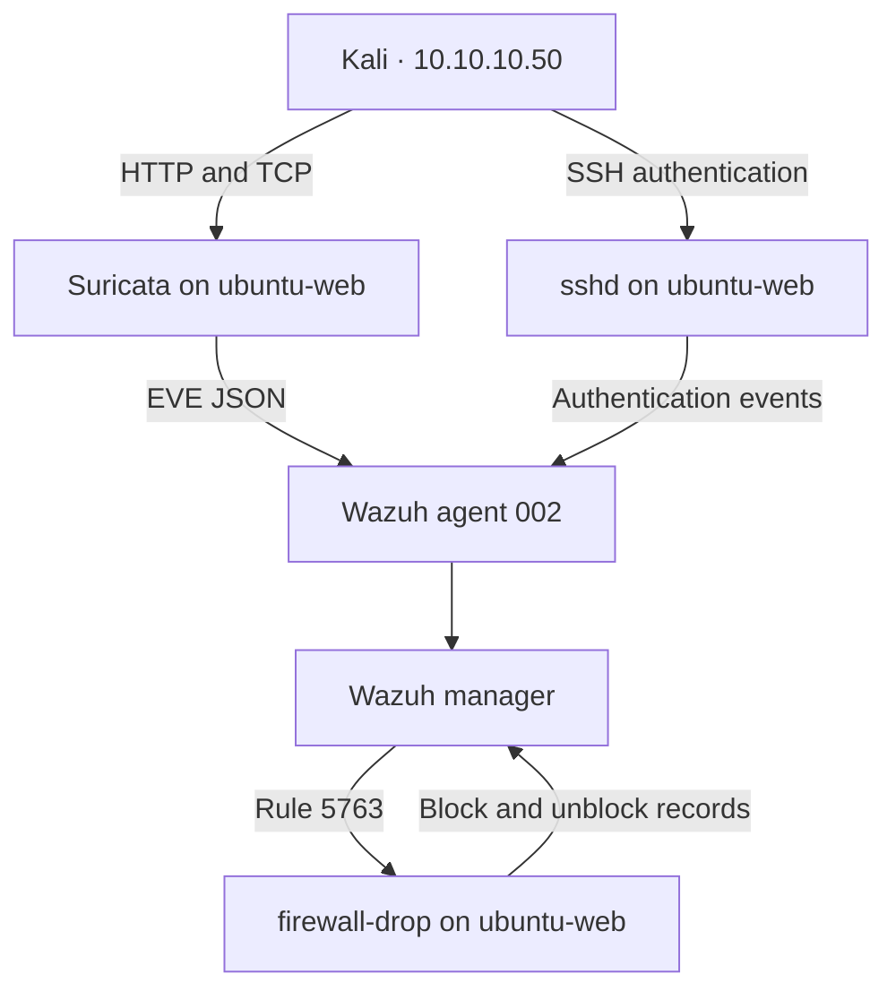

# Network and SSH event paths

The sensor’s local TCP alerts and the manager’s HTTP and SSH alerts have different identifiers. The numbers are mapped in the [test results](../README.md#tests-and-results).
